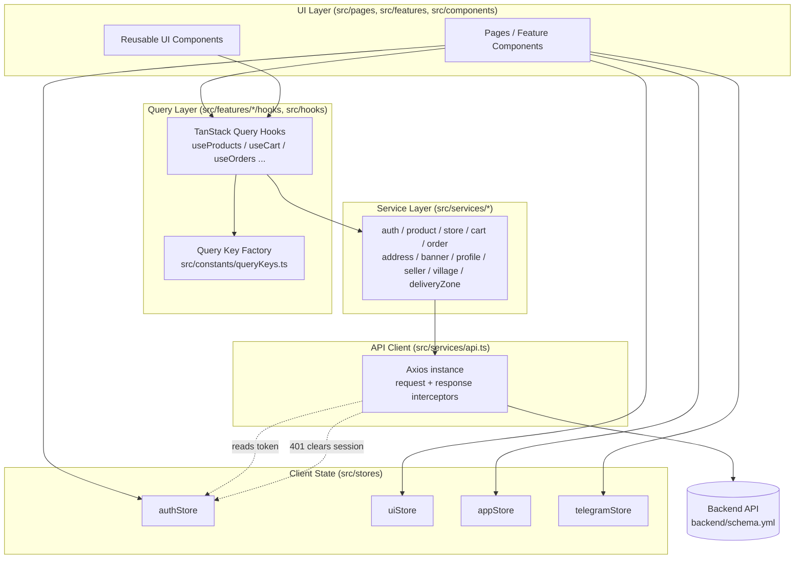
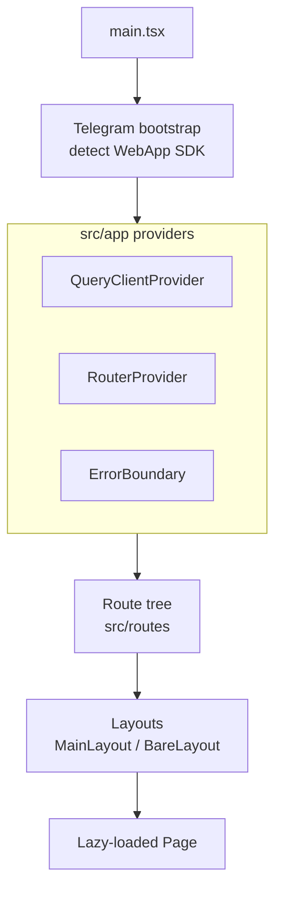
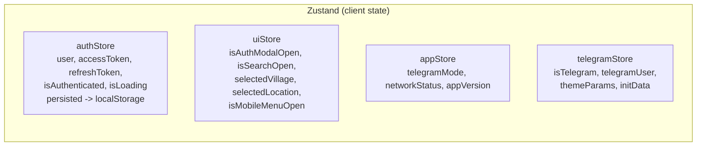
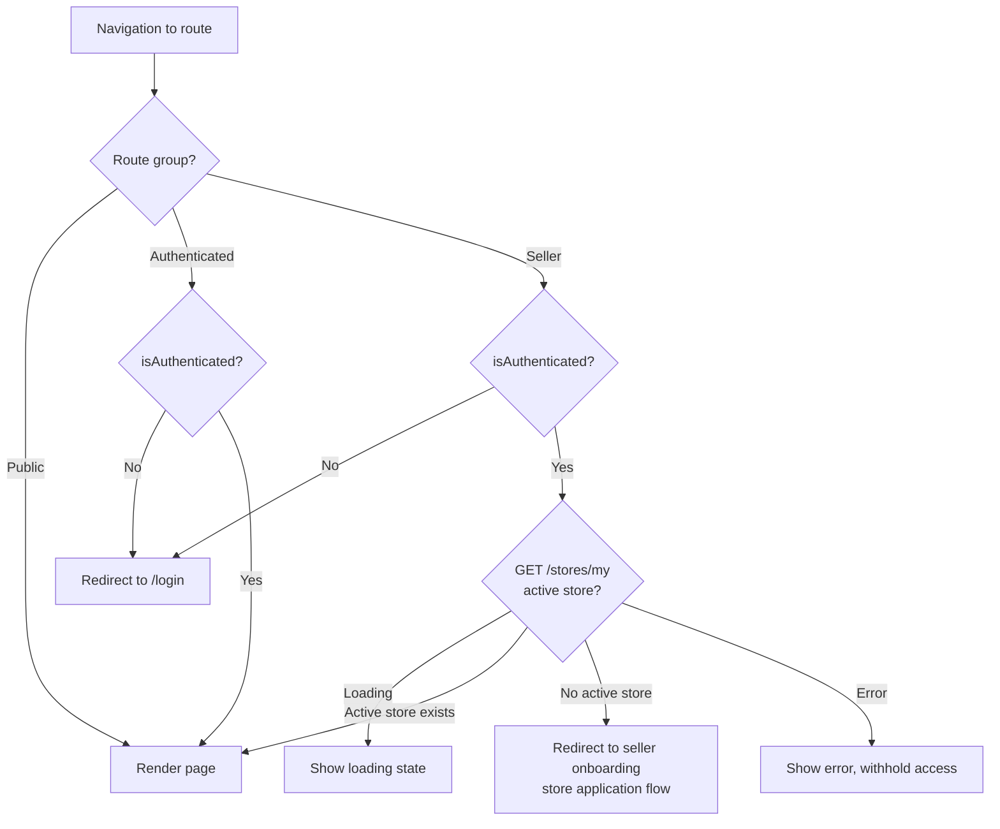
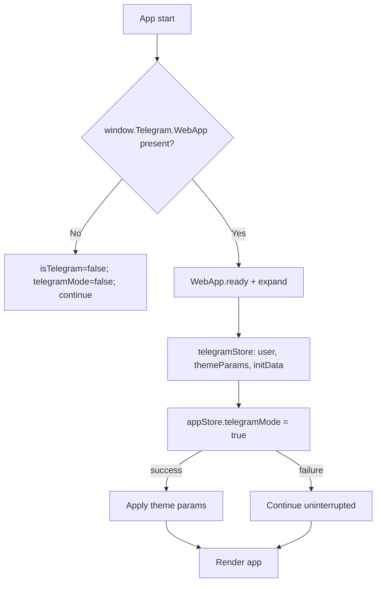
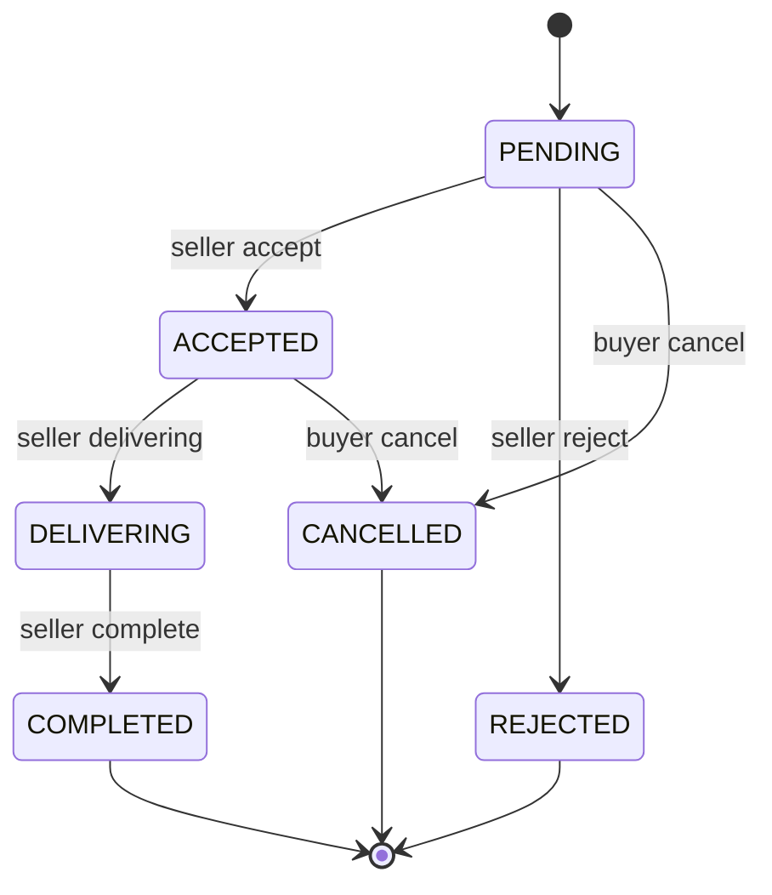
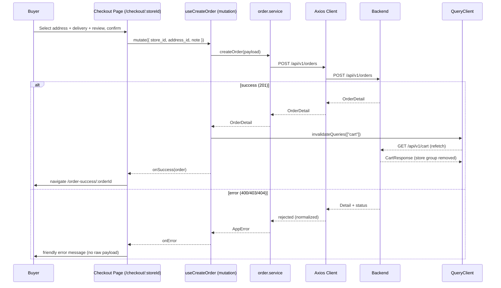
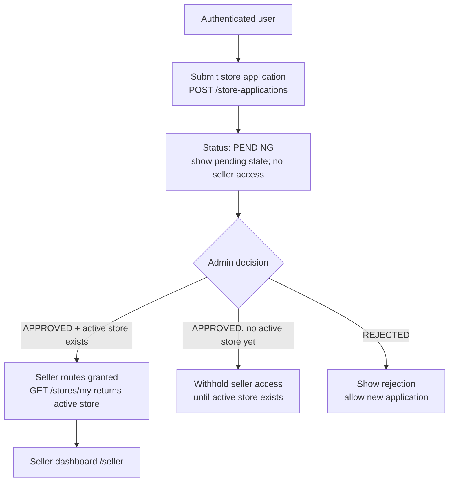
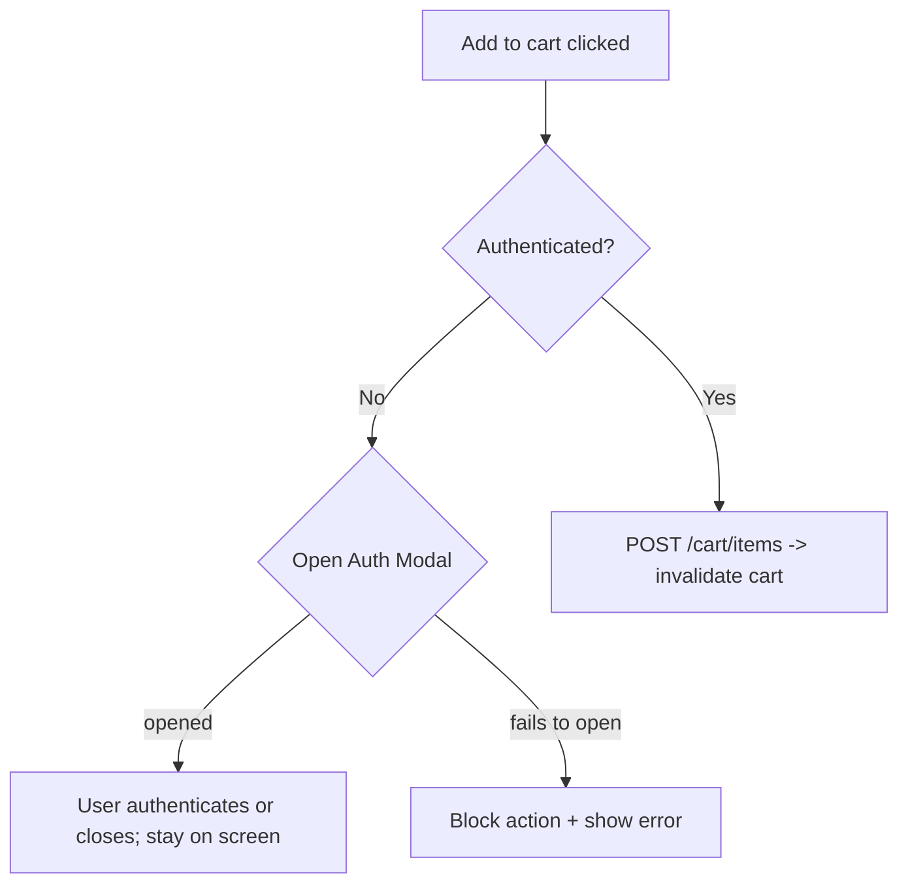

# Design Document

## Overview

SuxonaShop Frontend is a production-oriented, mobile-first, multi-vendor marketplace single-page application (SPA) built with **React + TypeScript + Vite**. It is optimized primarily for the **Telegram Mini App** runtime while providing full browser support (mobile and desktop). The frontend integrates exclusively with the SuxonaShop backend described by the OpenAPI document at `backend/schema.yml`, which is the **single source of truth** for every request shape, response shape, status code, and enumeration. Where any reference document (routing/navigation, state-management, design-system docs) conflicts with the schema, the schema prevails.

The design is organized around a small set of strict rules that the rest of the document elaborates:

- **Server state lives only in TanStack Query.** Products, categories, stores, delivery zones, villages, the cart, orders, profile, banners, and store applications are all server state. They are never copied into Zustand or localStorage.
- **Client state lives only in Zustand**, split across four stores (`authStore`, `uiStore`, `appStore`, `telegramStore`).
- **The cart is server-side state** retrieved grouped by store under the query key `["cart"]`. Every cart mutation invalidates `["cart"]`.
- **A strict layering rule:** UI components consume Query Layer hooks; hooks call the Service Layer; the Service Layer is the only layer permitted to touch the Axios API Client; the API Client talks to the backend. **Components never call Axios directly.**
- **Telegram auto-login is future work.** The MVP authenticates with phone + password (JWT). The architecture captures Telegram environment data and isolates auth behind a strategy abstraction so Telegram auto-login can be added later without touching the Query Layer or other stores.

This document covers architecture, folder structure, state management, API integration and type generation, routing and guards, Telegram integration, data models derived from the schema, the per-store checkout and cart-invalidation flows, seller onboarding, cross-cutting concerns (loading/empty/error states, accessibility, performance, design tokens), correctness properties for property-based testing, error handling, and a testing strategy with a requirements traceability summary.

### Technology Stack

| Concern | Choice |
| --- | --- |
| Framework / Language | React 18 + TypeScript (strict mode, no `any`) |
| Build tool | Vite |
| Routing | React Router |
| Server state | TanStack Query (React Query) |
| Client state | Zustand (with `persist` middleware for `authStore`) |
| HTTP | Axios (single instance with interceptors) |
| Forms / Validation | React Hook Form + Zod |
| Styling | Tailwind CSS (theme configured with design-system tokens) |
| Type generation | `openapi-typescript` against `backend/schema.yml` |

## Architecture

### Layered Architecture

The application enforces a unidirectional dependency flow. Each layer may only depend on the layer directly beneath it. The Service Layer is the sole consumer of the API Client, and UI components are the sole consumers of the Query Layer hooks (plus Zustand stores for client state).



**Layer responsibilities:**

- **UI Layer** — Renders screens and widgets, reads server state via Query Layer hooks, reads/writes client state via Zustand stores, and triggers mutations. It contains no HTTP logic.
- **Query Layer** — Owns all server state. Wraps service calls in `useQuery`, `useInfiniteQuery`, and `useMutation`. Defines caching defaults, query keys (via the central factory), and invalidation rules.
- **Service Layer** — Typed functions that map 1:1 to backend operations. The only layer permitted to import and call the Axios client. Returns schema-generated types.
- **API Client** — A single Axios instance with request/response interceptors for auth-token attachment and 401 handling. Reads the access token from `authStore` and clears the session on 401.
- **Backend** — The Django REST API described by the schema. Treated as the source of truth and as untrusted input that must be normalized before reaching the UI.

The `any` type is forbidden and TypeScript strict mode is always on (Requirement 1.6).

### Runtime Composition



## Project Structure

The project follows the mandated feature-based architecture from `docs/frontend/07-development-rules.md`:

```text
src/
├── app/            # App bootstrap: providers, QueryClient, ErrorBoundary, App root
├── pages/          # Route-level page components (lazy-loaded), thin composition of features
├── features/       # Feature modules: features/<name>/{components,hooks}
├── components/
│   └── ui/         # Reusable, design-system UI primitives (Button, Input, Modal, Card, Badge, Skeleton, state components)
├── services/       # API client + typed service modules (only layer that calls Axios)
├── hooks/          # Cross-cutting hooks (e.g., useDebounce, useNetworkStatus)
├── stores/         # Zustand client-state stores (authStore, uiStore, appStore, telegramStore)
├── types/          # Generated schema types + shared/feature-facing domain types
├── utils/          # Pure utilities (error normalization, formatting, money, cart derivations)
├── routes/         # Central route definitions, route groups, guards
├── layouts/        # MainLayout (with bottom nav) and BareLayout (no nav)
├── assets/         # Static assets, illustrations for empty states, icons
└── constants/      # queryKeys factory, route paths, design tokens, app constants
```

### What Lives Where

- **`src/app`** — Application composition root. Creates the `QueryClient` with default config, mounts `QueryClientProvider`, `RouterProvider`, and the top-level `ErrorBoundary`. Runs the Telegram bootstrap before render.
- **`src/pages`** — One component per route. Pages are thin: they wire layout, read hooks, and delegate to feature components. All page modules are lazy-loaded (Requirement 27.2).
- **`src/features/<name>`** — Self-contained feature modules. Each holds its own `components/` (feature-specific UI) and `hooks/` (Query Layer hooks for that feature). Example: `features/cart/{components,hooks}`, `features/product/{components,hooks}`, `features/seller/{components,hooks}`. Feature hooks import from `src/services` and `src/constants/queryKeys`.
- **`src/components/ui`** — Shared, reusable primitives with no feature knowledge: `Button`, `Input`, `Modal`/bottom-sheet, `Badge`, `Card`, `Skeleton`, and the standardized state components (`LoadingState`, `EmptyState`, `ErrorState`).
- **`src/services`** — `api.ts` (the Axios instance) plus one module per backend domain. The only place Axios is imported.
- **`src/stores`** — The four Zustand stores. No server data is stored here.
- **`src/types`** — `schema.d.ts` (generated) plus hand-written domain aliases that map generated types into ergonomic feature types.
- **`src/routes`** — `paths.ts` (central path constants), `routes.tsx` (route tree and groups), and guard components (`ProtectedRoute`, `SellerRoute`).
- **`src/constants`** — `queryKeys.ts` (central query key factory), `tokens.ts` (design tokens mirrored for non-Tailwind use), and other constants.

### Feature-Module Pattern

Each feature is organized so that server-state access and feature UI are colocated, while remaining strictly layered:

```text
features/cart/
├── components/
│   ├── CartStoreGroup.tsx
│   ├── CartItemRow.tsx
│   └── CartSummary.tsx
└── hooks/
    ├── useCart.ts            # useQuery(["cart"]) -> cartService.getCart()
    ├── useAddCartItem.ts     # useMutation -> invalidates ["cart"]
    ├── useUpdateCartItem.ts
    ├── useRemoveCartItem.ts
    └── useClearCart.ts
```

Feature components consume the feature hooks; the feature hooks consume the service layer; nothing in `features/` imports Axios.

## Components and Interfaces

This section defines the principal components of each layer and the interfaces (hook signatures and service signatures) through which they collaborate. Components depend only on the layer directly beneath them (UI → Query hooks → Services → API Client).

### UI Components

- **Page components (`src/pages`)** — one per route, lazy-loaded, thin composition of feature components and layouts. Examples: `HomePage`, `SearchPage`, `ProductDetailPage`, `CartPage`, `CheckoutPage`, `OrdersPage`, `ProfilePage`, `SellerDashboardPage`.
- **Feature components (`src/features/<name>/components`)** — feature-specific UI such as `ProductCard`, `StoreCard`, `CartStoreGroup`, `CartItemRow`, `CheckoutStepper`, `OrderStatusBadge`, `SellerProductForm`.
- **Reusable UI primitives (`src/components/ui`)** — `Button`, `Input`, `Modal` (bottom-sheet), `Badge`, `Card`, `Skeleton`, and the standardized state components `LoadingState`, `EmptyState`, `ErrorState`.
- **Layouts (`src/layouts`)** — `MainLayout` (bottom navigation) and `BareLayout` (no navigation).
- **Guards (`src/routes`)** — `ProtectedRoute`, `SellerRoute`.

### Query Layer Hook Interfaces

Hooks are the only interface UI components use for server state. Representative signatures:

```ts
// products
function useProducts(filters?: ProductFilters): UseInfiniteQueryResult<ProductSummary>;
function useProduct(id: number): UseQueryResult<Product, AppError>;
function useMyProducts(): UseInfiniteQueryResult<ProductSummary>;

// stores
function useStores(filters?: StoreFilters): UseInfiniteQueryResult<StoreSummary>;
function useStore(storeId: number): UseQueryResult<Store, AppError>;
function useMyStore(): UseQueryResult<Store, AppError>;
function useStoreDeliveryZones(storeId: number): UseQueryResult<DeliveryZone[], AppError>;

// cart (server state)
function useCart(): UseQueryResult<Cart, AppError>;
function useAddCartItem(): UseMutationResult<CartItem, AppError, CartItemCreate>;
function useUpdateCartItem(): UseMutationResult<CartItem, AppError, { itemId: number; quantity: number }>;
function useRemoveCartItem(): UseMutationResult<void, AppError, number>;
function useClearCart(): UseMutationResult<void, AppError, void>;

// orders
function useMyOrders(): UseInfiniteQueryResult<OrderSummary>;
function useStoreOrders(): UseInfiniteQueryResult<OrderSummary>;
function useOrder(id: number): UseQueryResult<Order, AppError>;
function useCreateOrder(): UseMutationResult<Order, AppError, OrderCreate>;

// other server state
function useCategories(): UseQueryResult<Category[], AppError>;
function useBanners(): UseQueryResult<Banner[], AppError>;
function useVillages(): UseQueryResult<Village[], AppError>;
function useProfile(): UseQueryResult<User, AppError>;
function useSellerApplication(): UseMutationResult<StoreApplication, AppError, StoreApplicationCreate>;
```

All cart and order-creation mutations invalidate `["cart"]` on success (Requirements 15.5, 16.3); seller order transitions refresh the affected order and list (Requirement 23.8).

### Service Layer Interfaces

Services are the only modules that import the Axios client. Representative signatures:

```ts
// auth.service.ts
export const authService = {
  login(body: Login): Promise<TokenPair>,
  register(body: Register): Promise<RegisterResponse>,
  me(): Promise<User>,
};

// cart.service.ts
export const cartService = {
  getCart(): Promise<Cart>,
  addItem(body: CartItemCreate): Promise<CartItem>,
  updateItem(itemId: number, body: { quantity: number }): Promise<CartItem>,
  removeItem(itemId: number): Promise<void>,
  clear(): Promise<void>,
};

// order.service.ts
export const orderService = {
  create(body: OrderCreate): Promise<Order>,
  get(orderId: number): Promise<Order>,
  myOrders(page: number): Promise<Paginated<OrderSummary>>,
  storeOrders(page: number): Promise<Paginated<OrderSummary>>,
  cancel(orderId: number): Promise<Order>,
  accept(orderId: number): Promise<Order>,
  reject(orderId: number, reason?: string): Promise<Order>,
  delivering(orderId: number): Promise<Order>,
  complete(orderId: number): Promise<Order>,
};
```

### Client-State Interfaces

The four Zustand stores (`authStore`, `uiStore`, `appStore`, `telegramStore`) and their state/action shapes are defined in the State Management Design section below.

### Pure-Logic Utilities (`src/utils`)

These framework-agnostic functions hold the property-tested logic:

```ts
function normalizeError(error: unknown): AppError;
function groupCartByStore(cart: Cart): CartStoreGroup[];               // partition invariant (Property 7)
function removeStoreGroup(cart: Cart, storeId: number): Cart;          // checkout removal invariant (Property 8)
function selectScreenState(s: { isLoading: boolean; isError: boolean; data: unknown }): "LOADING" | "ERROR" | "EMPTY" | "SUCCESS";
function orderStatusLabel(status: OrderStatus): string;               // totality (Property 9)
function canAccessSellerRoutes(ctx: { isAuthenticated: boolean; hasActiveStore: boolean }): SellerAccessDecision;
function encodeSearchTerm(term: string): string;                      // <-> q param round-trip (Property 12)
```

## State Management Design

State is split by ownership. The decision rule: **if the data originates from the backend, it is server state (TanStack Query). Otherwise it is client state (Zustand).** (Requirements 26.1–26.3.)

### Zustand Stores (Client State Only)



#### authStore

Holds the authenticated session. Persisted to `localStorage` via Zustand's `persist` middleware. Authentication tokens are the **only** sensitive values placed in localStorage (Requirements 2.3, 2.8).

```ts
interface AuthState {
  user: User | null;
  accessToken: string | null;
  refreshToken: string | null;
  isAuthenticated: boolean;
  isLoading: boolean;
  // actions
  login(tokens: TokenPair, user?: User): void; // store TokenPair; set authenticated
  logout(): void;                               // clear user + tokens (Req 2.7)
  setUser(user: User): void;
  clearUser(): void;                            // clear session (used by 401 handler, Req 2.4/2.6)
}
```

Persisted keys: `accessToken`, `refreshToken`, `user` (Requirement 2.3).

#### uiStore

Global UI state, not persisted.

```ts
interface UIState {
  isAuthModalOpen: boolean;
  isSearchOpen: boolean;
  selectedVillage: Village | null;
  selectedLocation: string | null;
  isMobileMenuOpen: boolean;
  openAuthModal(): void;
  closeAuthModal(): void;
  setVillage(v: Village | null): void;
  setLocation(loc: string | null): void;
  toggleMobileMenu(): void;
}
```

#### appStore

Global application state.

```ts
interface AppState {
  telegramMode: boolean;
  networkStatus: "online" | "offline";
  appVersion: string;
  setTelegramMode(active: boolean): void;
  setNetworkStatus(status: "online" | "offline"): void;
}
```

`networkStatus` is driven by browser `online`/`offline` events; when offline, the UI surfaces a standardized message (Requirement 24.4).

#### telegramStore

Telegram Mini App integration state, populated by the bootstrap module.

```ts
interface TelegramState {
  isTelegram: boolean;
  telegramUser: TelegramUser | null;
  themeParams: TelegramTheme | null;
  initData: string | null;
  initializeTelegram(): void;
  setTelegramUser(u: TelegramUser | null): void;
  setTheme(t: TelegramTheme | null): void;
}
```

### TanStack Query (Server State Only)

The Query Layer is the exclusive owner of all server state (Requirement 26.1): cart, products, stores, categories, orders, profile, villages, delivery zones, banners, and the seller application/store.

#### Default Query Client Configuration

```ts
const queryClient = new QueryClient({
  defaultOptions: {
    queries: {
      staleTime: 5 * 60 * 1000,   // 5 minutes
      gcTime: 10 * 60 * 1000,     // 10 minutes
      refetchOnWindowFocus: false,
      retry: 1,
    },
  },
});
```

Rationale: Telegram Mini App users frequently switch apps; disabling refetch-on-focus and using generous stale/gc times keeps navigation smooth and reuses cached data (Requirement 27.3).

#### Centralized Query Key Factory

All query keys are defined in `src/constants/queryKeys.ts` (Requirements 26.4). A single factory prevents key drift and makes invalidation precise.

```ts
export const queryKeys = {
  banners: () => ["banners"] as const,
  categories: () => ["categories"] as const,
  products: (filters?: ProductFilters) => ["products", filters ?? {}] as const,
  product: (id: number) => ["product", id] as const,
  myProducts: () => ["products", "my"] as const,
  stores: (filters?: StoreFilters) => ["stores", filters ?? {}] as const,
  store: (id: number) => ["store", id] as const,
  myStore: () => ["stores", "my"] as const,
  storeDeliveryZones: (id: number) => ["store", id, "delivery-zones"] as const,
  villages: () => ["villages"] as const,
  cart: () => ["cart"] as const,
  orders: () => ["orders", "my"] as const,
  storeOrders: () => ["orders", "store"] as const,
  order: (id: number) => ["order", id] as const,
  profile: () => ["profile"] as const,
  sellerApplication: () => ["seller-application"] as const,
} as const;
```

#### Infinite Queries

Products, stores, and orders use `useInfiniteQuery` advancing the page-number cursor (`?page=N`) returned by the paginated backend list endpoints (`Paginated*List` schemas expose `count`, `next`, `previous`, `results`). `getNextPageParam` derives the next page from the presence of `next` (Requirements 9.5, 11.1, 17.1, 23.1, 26.5).

### Cart Is Server-Side State

The cart is retrieved from `GET /api/v1/cart` under query key `["cart"]` and is **never** stored in Zustand or localStorage (Requirements 14.1–14.3). All four mutations invalidate `["cart"]` on success (Requirement 15.5):

| Action | Endpoint | Mutation hook |
| --- | --- | --- |
| Add item | `POST /api/v1/cart/items` | `useAddCartItem` |
| Update quantity | `PATCH /api/v1/cart/items/{item_id}` | `useUpdateCartItem` |
| Remove item | `DELETE /api/v1/cart/items/{item_id}` | `useRemoveCartItem` |
| Clear cart | `DELETE /api/v1/cart` | `useClearCart` |

Guests have no cart; an add-to-cart attempt opens the Auth Modal instead (Requirements 13.1, 13.3).

## API Integration Design

### Axios Instance (`src/services/api.ts`)

A single Axios instance is configured with the base URL read from the `VITE_API_URL` environment variable (Requirement 1.3) and two interceptors.

```ts
import axios from "axios";

export const api = axios.create({
  baseURL: import.meta.env.VITE_API_URL,
  headers: { "Content-Type": "application/json" },
});

// Request interceptor: attach Bearer token from authStore (Req 2.2)
api.interceptors.request.use((config) => {
  const token = useAuthStore.getState().accessToken;
  if (token) {
    config.headers.Authorization = `Bearer ${token}`;
  }
  return config;
});

// Response interceptor: normalize errors + handle 401 (Req 2.4, 24.1)
api.interceptors.response.use(
  (response) => response,
  (error) => {
    if (error.response?.status === 401) {
      useAuthStore.getState().clearUser(); // clear session (Req 2.4)
      try {
        redirectToLogin();                  // route to /login
      } catch {
        // Req 2.5: session stays cleared; allow manual navigation
      }
    }
    return Promise.reject(normalizeError(error)); // standardized { message, status }
  },
);
```

The 401 handler clears the session unconditionally; if the redirect fails the cleared state is retained and the user may navigate manually (Requirements 2.4, 2.5). Logout and other non-401 session-ending paths reuse `clearUser`/`logout` (Requirements 2.6, 2.7).

### Service Modules

One module per backend domain, each exposing typed functions that map to schema operations. These are the only modules that import `api`.

| Service | Backend operations |
| --- | --- |
| `auth.service.ts` | `POST /auth/login`, `POST /auth/register`, `GET /auth/me` |
| `product.service.ts` | `GET /products`, `GET /products/{product_id}`, `GET /products/my`, `POST/PATCH/DELETE /products`, image endpoints |
| `store.service.ts` | `GET /stores`, `GET /stores/{store_id}`, `GET /stores/{store_id}/delivery-zones`, `GET/PATCH /stores/my` |
| `cart.service.ts` | `GET /cart`, `POST /cart/items`, `PATCH/DELETE /cart/items/{item_id}`, `DELETE /cart` |
| `order.service.ts` | `POST /orders`, `GET /orders/{order_id}`, `GET /orders/my`, `GET /orders/store`, transition actions (`accept`/`reject`/`delivering`/`complete`/`cancel`) |
| `address.service.ts` | `GET/POST /addresses`, `GET/PATCH/DELETE /addresses/{address_id}` |
| `banner.service.ts` | `GET /banners/` |
| `profile.service.ts` | `GET /auth/me` (profile view) |
| `seller.service.ts` | `POST /store-applications`, `GET /stores/my` |
| `village.service.ts` | `GET /villages` |
| `deliveryZone.service.ts` | `POST /delivery-zones`, `PATCH/DELETE /delivery-zones/{zone_id}` |

### Type Generation Workflow

TypeScript types are generated from the schema rather than hand-written, keeping the client aligned with the source of truth (Requirements 1.2).

- **Tool:** `openapi-typescript`.
- **Command (npm script):** `"generate:api": "openapi-typescript ../backend/schema.yml -o src/types/schema.d.ts"`.
- **Output:** `src/types/schema.d.ts` exposing `components["schemas"][...]`.
- **Usage:** Feature-facing aliases in `src/types/*.ts` re-export ergonomic names, e.g. `export type Product = components["schemas"]["ProductDetail"];`.
- **Process:** Regenerate whenever `schema.yml` changes; the generated file is committed so CI and reviewers can diff API surface changes. Service modules and hooks consume only the aliased types.

### Standardized Error Shape and Normalization

Backend errors use the `Detail` schema (`{ "detail": string }`) plus an HTTP status. The frontend normalizes every failure into a single shape (Requirements 24.1, 24.2):

```ts
export interface AppError {
  message: string; // user-friendly; never a raw server payload or stack trace
  status: number;  // HTTP status (0 for network/offline)
}

export function normalizeError(error: unknown): AppError { /* maps Axios/Detail/network -> AppError */ }
```

`normalizeError` maps known statuses to friendly copy (e.g., 401 -> "Please sign in again", 403 -> "You don't have permission to do that", 409 -> transition-specific messages, network failure -> status `0` with an offline message). Raw server responses and stack traces are never shown to users (Requirement 24.2).

## Routing Design

### Central Route Definitions

All paths are defined as constants in `src/routes/paths.ts` and the route tree is assembled in `src/routes/routes.tsx`; components reference path constants rather than hardcoded strings (Requirements 6.5). All page-level routes are lazy-loaded via `React.lazy` + `Suspense` (Requirement 27.2).

### Route Groups

| Group | Routes | Access |
| --- | --- | --- |
| **Public** | `/`, `/search`, `/stores`, `/store/:storeId`, `/product/:id`, `/category/:slug`, `/login`, `/register` | Guests allowed (Req 6.1) |
| **Authenticated** | `/cart`, `/checkout/:storeId`, `/order-success/:orderId`, `/orders`, `/orders/:id`, `/profile`, `/addresses` | Requires auth (Req 6.2) |
| **Seller** | `/seller`, `/seller/products`, `/seller/products/create`, `/seller/products/:id/edit`, `/seller/orders`, `/seller/orders/:id`, `/seller/statistics`, `/seller/settings` | Requires auth + active store (Req 6.3) |
| **System** | `/404` (not found), `/unauthorized` | Always |

### Route Guards



- **`ProtectedRoute`** — Reads `isAuthenticated` from `authStore`. If not authenticated, redirects to `/login` (Requirement 6.2).
- **`SellerRoute`** — Requires authentication, then resolves active store ownership via the `useMyStore` hook (`GET /api/v1/stores/my`). An authenticated user without an active store is redirected to the seller onboarding (store application) flow in all cases (Requirements 6.3, 6.4, 20.8). Active-store ownership takes precedence over any separate pending application (Requirement 20.5); an approved application with no active store yet still withholds access (Requirement 20.6).

### Layouts and Bottom Navigation

Two layouts:

- **`MainLayout`** — Renders the fixed bottom navigation bar with five tabs (Home `/`, Search `/search`, Cart `/cart`, Stores `/stores`, Profile `/profile`) and an `Outlet` for the page (Requirements 7.1, 7.4).
- **`BareLayout`** — No bottom navigation. Used for `/login`, `/register`, `/checkout/:storeId`, and seller onboarding (Requirement 7.3).

The bottom navigation remains visible on primary screens (Requirement 7.2) and is hidden on the bare-layout screens (Requirement 7.3).

### Deep Linking and 404

Direct access to `/product/:id`, `/store/:storeId`, and `/orders/:id` is supported from browser, Telegram Mini App, and shared links (the route tree resolves these on first load and the corresponding query hooks fetch the entity). Unknown routes render a Not Found page at `/404` (Requirements 6.6).

### Route Parameter Strategy: slug vs id (Schema Reconciliation)

The navigation doc references `/store/:slug` and `/product/:id`, but the **schema is the source of truth** and exposes **integer identifiers only**:

- Stores are retrieved by integer `store_id` via `GET /api/v1/stores/{store_id}`; `StoreList`/`StoreDetail` expose `id` and `name` but **no `slug` field**.
- Products are retrieved by integer `product_id` via `GET /api/v1/products/{product_id}`; the product list is filtered by store **id** (`?store=<id>`), and `ProductList` exposes `store_id`/`category_id`.

**Decision:** Use **id-based route parameters aligned to the schema.** The store detail route is `/store/:storeId` where `:storeId` is the integer `store_id`, and the product route is `/product/:id` where `:id` is the integer `product_id`. The route guards and hooks parse the param as an integer and pass it straight to the service call. This avoids a slug-resolution round trip the backend cannot serve, since no slug field exists.

If human-readable URLs become desirable later, a non-breaking enhancement is a hybrid `/<id>-<name-slug>` segment where only the leading integer is parsed and the trailing slug is cosmetic; this requires no backend change and does not affect the Query Layer. The MVP ships with plain id params.

## Telegram Mini App Integration Design

### Bootstrap Module

A `telegram/bootstrap.ts` module runs before the React tree renders. It:

1. Detects the Telegram WebApp SDK (`window.Telegram?.WebApp`).
2. If present, calls `ready()`/`expand()`, then populates `telegramStore` with `isTelegram = true`, `telegramUser`, `themeParams`, and `initData` (Requirement 5.1).
3. Sets `appStore.telegramMode = true` (Requirement 5.4). If recording Telegram mode fails while detection succeeded, the app continues without interruption (Requirement 5.5).
4. Applies theme params (maps Telegram theme colors onto CSS variables) for visual consistency.
5. **Does not** perform any init-data-to-JWT exchange — that is explicitly out of MVP scope (Requirement 5.2).



### Auth Strategy Abstraction

To allow Telegram auto-login to be added later without touching the Query Layer or other stores (Requirements 5.3, 3 of Req 5), authentication is hidden behind a strategy interface consumed only by the auth feature:

```ts
interface AuthStrategy {
  readonly id: "password" | "telegram";
  authenticate(input: unknown): Promise<{ tokens: TokenPair; user?: User }>;
}

// MVP: only PasswordAuthStrategy is registered.
// Future: TelegramAuthStrategy implements the same interface and is registered
// without changing authStore, the Query Layer, or other stores.
```

The login flow calls the active strategy and writes the resulting `TokenPair` into `authStore`. Adding `TelegramAuthStrategy` later is purely additive.

## Data Models

TypeScript types are generated from the schema (`openapi-typescript`) and surfaced as ergonomic feature aliases. The table below maps the key generated schema types to the feature types used in the app. All money fields (`price`, `subtotal`, `total`, `delivery_price`) are **decimal strings** in the schema and must be treated as strings in transport, parsed only for display/derivation.

| Feature type (alias) | Generated schema source | Notes |
| --- | --- | --- |
| `User` | `UserDetail` | `id, phone, first_name, last_name, is_active` |
| `UserCompact` | `UserCompact` | nested in orders/applications |
| `TokenPair` | `TokenPair` | `{ access, refresh }` — stored in `authStore` |
| `Product` | `ProductDetail` | full detail incl. `store`, `category`, `images[]`, `status` |
| `ProductSummary` | `ProductList` | grid/list item; `store_id`, `category_id`, `primary_image` |
| `ProductImage` | `ProductImage` | `is_primary`, `sort_order` |
| `Store` | `StoreDetail` | full store incl. `owner`, `status` |
| `StoreSummary` | `StoreList` | list item: `id, name, logo, banner, status` |
| `Category` | `Category` | `parent` (nullable), `name`, `icon`, `is_active` |
| `Cart` | `CartResponse` | `{ stores: CartStoreGroup[] }` |
| `CartStoreGroup` | `CartStoreGroupResponse` | `{ store_id, store_name }` (+ items as returned) |
| `CartItem` | `CartItem` | `{ id, product: ProductList, quantity }` |
| `Order` | `OrderDetail` | `customer, store, address, items[], subtotal, delivery_price, total, status, note` |
| `OrderSummary` | `OrderList` | list item with `store_id`, `status`, totals |
| `OrderItem` | `OrderItem` | `product, price, quantity, subtotal` |
| `OrderStatus` | `OrderStatusEnum` | `PENDING \| ACCEPTED \| DELIVERING \| COMPLETED \| CANCELLED \| REJECTED` |
| `StoreApplication` | `StoreApplicationDetail` | `owner, store_name, phone, status, admin_note` |
| `StoreApplicationStatus` | `StoreApplicationStatusEnum` | `PENDING \| APPROVED \| REJECTED` |
| `Address` | `AddressDetail` | nested `village`, `is_default` |
| `Village` | `Village` | `id, name, district, is_active` |
| `DeliveryZone` | `DeliveryZoneList` | nested `village`, `delivery_price`, `is_active` |
| `Banner` | `BannerList` | `id, title, image, url, sort_order` |

### Representative Interface Snippets

These illustrate how generated types are aliased; they are illustrative, not generated source.

```ts
import type { components } from "./schema";

export type User = components["schemas"]["UserDetail"];
export type TokenPair = components["schemas"]["TokenPair"];

export type ProductSummary = components["schemas"]["ProductList"];
export type Product = components["schemas"]["ProductDetail"];

export type Cart = components["schemas"]["CartResponse"];
export type CartStoreGroup = components["schemas"]["CartStoreGroupResponse"];
export type CartItem = components["schemas"]["CartItem"];

export type Order = components["schemas"]["OrderDetail"];
export type OrderStatus = components["schemas"]["OrderStatusEnum"];

export type StoreApplication = components["schemas"]["StoreApplicationDetail"];
export type StoreApplicationStatus = components["schemas"]["StoreApplicationStatusEnum"];
```

### Order Status Model



The frontend renders statuses using exactly the `OrderStatusEnum` values; invalid transitions are signaled by the backend with HTTP 409 and surfaced as friendly messages (Requirements 17.4, 17.6, 23.7).

## Per-Store Checkout and Cart Invalidation Flow

Checkout is scoped to a single store (`/checkout/:storeId`). A multi-step flow collects delivery method, contact info, and an order review before creating the order (Requirements 16.1, 16.5, 16.7). On success, the `["cart"]` query is invalidated so the checked-out store's items disappear while other stores' items remain, and the app navigates to `/order-success/:orderId` (Requirements 16.3, 16.4).



Cart mutations (add/update/remove/clear) follow the same invalidation pattern: on success they invalidate `["cart"]`, and on error (400/403/404) they surface a friendly message (Requirements 15.5, 15.6).

## Seller Onboarding Flow



- Application status maps to `StoreApplicationStatusEnum` (`PENDING/APPROVED/REJECTED`) (Requirement 20.2).
- Pending withholds seller access (Requirement 20.3); approved-with-active-store grants it (Requirement 20.4); approved-without-active-store withholds it (Requirement 20.6); rejected allows re-application (Requirement 20.7).
- Active store ownership (`GET /stores/my`) is the authoritative gate and takes precedence over a separate pending application (Requirements 20.5, 20.8).

## Guest Add-to-Cart Gating



Guests never get a cart; the add-to-cart action opens the Auth Modal (Requirements 13.1, 13.3). If the modal fails to open, the action is blocked and an error is shown (Requirement 13.2). Closing the modal without authenticating keeps the user on the current screen (Requirement 13.4).

## Cross-Cutting Concerns

### Standardized Async States

A small set of reusable components in `src/components/ui` standardizes the four async states required on every async screen (Requirements 25.1–25.4):

- `LoadingState` / domain skeletons (`ProductGridSkeleton`, `CartSkeleton`, etc.) — never a blank screen (Requirements 25.1, 27.4).
- `EmptyState` — illustration, title, description, action button (cart, orders, products, search) (Requirement 25.3).
- `ErrorState` — friendly message plus a retry action for retryable failures (Requirements 25.4, 24.3).
- Success state — the rendered data.

A screen-level helper composes these from a query's `isLoading`/`isError`/`data` so the pattern is applied consistently.

### Error Boundary

A top-level `ErrorBoundary` in `src/app` catches render-time exceptions and shows a friendly fallback, preventing white screens and raw error exposure (Requirements 24.2).

### Accessibility

- Interactive touch targets are at least 44x44px (Requirement 28.1).
- Buttons and inputs are keyboard-operable (Requirement 28.2).
- Semantic HTML elements are used for structure and controls (Requirement 28.3).
- Color contrast follows the design system tokens (Requirement 28.4).

### Performance

- All page-level routes are lazy-loaded; large seller features are code-split (Requirements 27.2).
- TanStack Query caching defaults make repeated navigation reuse cached data (Requirement 27.3).
- Skeletons guarantee no blank screens during fetches (Requirement 27.4).
- `useMemo`/`useCallback`/`React.memo` are used only where measurable.

### Design System Tokens (Tailwind Theme)

Design tokens from `docs/frontend/06-design-system.md` are configured in the Tailwind theme (and mirrored in `src/constants/tokens.ts` for non-class usage). No hardcoded colors/spacing/radii outside these tokens.

```ts
// tailwind.config — theme.extend (illustrative)
colors: {
  primary: { DEFAULT: "#22C55E", hover: "#16A34A" },
  background: "#FFFFFF",
  surface: "#F8FAFC",
  border: "#E2E8F0",
  text: { DEFAULT: "#0F172A", muted: "#64748B" },
  success: "#22C55E", warning: "#F59E0B", error: "#EF4444",
},
borderRadius: { sm: "8px", md: "12px", lg: "16px", xl: "24px" },
fontFamily: { sans: ["Inter", "sans-serif"] },
// spacing scale: 4,8,12,16,20,24,32,40,48,64 (px)
```

Responsive breakpoints target 320px, 375px, 768px, and 1280px with a centered max content width of 1280px and mobile-first priority (Requirement 27.1).


## Correctness Properties

*A property is a characteristic or behavior that should hold true across all valid executions of a system — essentially, a formal statement about what the system should do. Properties serve as the bridge between human-readable specifications and machine-verifiable correctness guarantees.*

These correctness properties apply to the **pure-logic layer** of this frontend: the request interceptor, session persistence/clearing, guard decision functions, cart grouping and per-store checkout derivations, status mapping, error normalization, the async screen-state selector, and form validation. UI rendering, routing wiring, and CRUD-to-endpoint mappings are not property-tested (they are covered by component, route-guard, and example/integration tests in the Testing Strategy). The properties below were derived from the prework analysis and consolidated to remove redundancy.

### Property 1: Authorization header attachment

*For any* access token value held in `authStore` and *any* outgoing request config, after the request interceptor runs the config carries the header `Authorization: Bearer <token>`; and *for any* config when no token is present, no `Authorization` header is added.

**Validates: Requirements 2.2**

### Property 2: Session persistence round-trip

*For any* authenticated session (access token, refresh token, and user), persisting the session to localStorage and then rehydrating `authStore` produces an equivalent session.

**Validates: Requirements 2.3, 2.8**

### Property 3: Session clearing on 401 or logout

*For any* prior authentication state, clearing the session (triggered by a 401 response or by logout) yields a state with null user and null tokens and `isAuthenticated = false`, and this holds even when a post-clear redirect fails.

**Validates: Requirements 2.4, 2.5, 2.6, 2.7**

### Property 4: Login form validation

*For any* pair of phone and password inputs, the login validation schema accepts the input if and only if both fields are non-empty (not whitespace-only) and the phone matches the schema phone pattern; otherwise it is rejected.

**Validates: Requirements 3.7**

### Property 5: Seller-access decision

*For any* combination of authentication status, active-store ownership, and store-application status, the seller-access decision grants access if and only if the user is authenticated and an active store exists; an authenticated user without an active store is routed to seller onboarding regardless of any pending or approved application, and active-store ownership takes precedence over a separate pending application.

**Validates: Requirements 6.3, 6.4, 20.4, 20.5, 20.6, 20.8**

### Property 6: Guest authenticated-route and add-to-cart gating

*For any* unauthenticated state, navigating to an authenticated route resolves to a redirect to the login screen, and activating add-to-cart resolves to "open the Auth Modal" while performing no cart mutation.

**Validates: Requirements 6.2, 13.1, 13.3**

### Property 7: Cart store-grouping partition invariant

*For any* cart response, the store-grouped view of the cart is a partition of its items: the union of all store groups equals the full set of cart items, every item belongs to exactly one group, and each group's key matches the store of the items it contains (no item lost, duplicated, or misattributed).

**Validates: Requirements 14.2**

### Property 8: Per-store checkout removal invariant

*For any* cart containing one or more store groups, after a successful checkout of store S and the subsequent cart refetch, the resulting cart contains no items belonging to S and every item belonging to any other store is unchanged.

**Validates: Requirements 16.3**

### Property 9: Order status mapping totality

*For any* value of `OrderStatusEnum` (PENDING, ACCEPTED, DELIVERING, COMPLETED, CANCELLED, REJECTED), the status-to-display mapping returns a defined, non-empty label/badge — the mapping is total over the enum.

**Validates: Requirements 17.4**

### Property 10: Error normalization

*For any* failure input (an Axios error carrying a `Detail` body, a network/offline failure, or an unknown thrown value), `normalizeError` returns an `AppError` whose `status` is a number and whose `message` is a non-empty, user-friendly string that is never the raw server payload or a stack trace.

**Validates: Requirements 15.6, 16.6, 19.6, 24.1, 24.2**

### Property 11: Async screen-state selector totality and precedence

*For any* combination of loading flag, error flag, and data value, the screen-state selector returns exactly one state following the precedence loading → error → empty → success: LOADING when loading; otherwise ERROR when an error is present; otherwise EMPTY when the data is absent or an empty collection; otherwise SUCCESS.

**Validates: Requirements 9.6, 9.7, 25.1, 25.2, 25.3, 25.4**

### Property 12: Search term URL round-trip

*For any* search term, encoding it into the `q` URL query parameter and then parsing it back yields the original term, regardless of how many results the search returns (including zero results).

**Validates: Requirements 12.4**

## Error Handling

- **Single normalized error type.** Every failure that reaches the UI is an `AppError { message: string; status: number }` produced by `normalizeError` in the Axios response interceptor and mutation/query error paths. Raw server responses and stack traces are never displayed (Requirements 24.1, 24.2).
- **401 unauthorized.** The response interceptor clears the session via `authStore.clearUser()` and redirects to `/login`. If the redirect fails, the cleared state is retained and the user can navigate manually (Requirements 2.4, 2.5).
- **403 forbidden / ownership errors.** Surfaced as "action not permitted" messages; unauthorized resource data is not displayed (Requirements 21.6, 22.7).
- **404 not found.** Product, store, and order detail screens render a Not Found state when the entity is missing or invalid (Requirements 10.5, 11.5).
- **409 invalid transition.** Order cancel/seller transition actions map 409 to a status-specific message that the transition is not allowed in the current status (Requirements 17.6, 23.7).
- **400 validation.** Login, registration, address, product, and cart flows map 400 to field-level or general validation messages derived from the standardized format (Requirements 4.6, 15.6, 19.6).
- **Network/offline.** `appStore.networkStatus` is set to `offline` on the browser offline event and a standardized offline message is shown (status `0`) (Requirement 24.4).
- **Retry.** Retryable failures render an `ErrorState` with a retry action that refetches the underlying query (Requirements 24.3, 25.4).
- **Render-time errors.** A top-level `ErrorBoundary` catches exceptions and shows a friendly fallback (Requirement 24.2).

## Testing Strategy

### Dual Approach

- **Unit / example tests** — specific behaviors, edge cases, and error conditions (e.g., 401 redirect, offline event, status-to-message mapping for a specific 409).
- **Property-based tests** — the universal properties in the Correctness Properties section, using a PBT library for the target language. The chosen library is **fast-check** (idiomatic for the TypeScript/Vitest stack). PBT is not implemented from scratch.
- **Component tests** — render-state coverage (loading/empty/error/success) for pages and feature components using React Testing Library; Telegram-vs-browser rendering branches.
- **Hook tests** — Query Layer hooks against a mocked service layer / `QueryClient`, asserting query keys, infinite-query page advancement, and that each cart/order mutation invalidates `["cart"]` (Requirements 15.5, 16.3) and refreshes affected order data (Requirement 23.8).
- **Route-guard tests** — `ProtectedRoute` and `SellerRoute` decisions across auth/active-store/application-status combinations (covered comprehensively by Property 5 and Property 6).

### Property Test Configuration

- Test runner: **Vitest**; PBT library: **fast-check**.
- Each property-based test runs a **minimum of 100 iterations**.
- Each property test is tagged with a comment referencing its design property in the format:
  `// Feature: suxonashop-frontend, Property {number}: {property_text}`
- Each correctness property is implemented by a **single** property-based test.
- Money fields are decimal strings; generators produce schema-valid decimal strings for totals/derivation tests.

### Where Property-Based Testing Applies (and Where It Does Not)

| Applies (PBT) | Does not apply (example/component/integration) |
| --- | --- |
| Error normalization (Property 10) | Home discovery rendering (8.x) |
| Cart grouping partition (Property 7) | Product/store detail rendering (10.x, 11.x) |
| Per-store checkout removal (Property 8) | Bottom-nav visibility (7.x) — component test |
| Async screen-state selector (Property 11) | CRUD-to-endpoint wiring (19.x, 21.x, 22.x, 23.x) — example/integration |
| Auth header / session / clearing (Properties 1–3) | Mutation cache invalidation calls (15.5) — hook/example test |
| Seller-access & guest gating decisions (Properties 5, 6) | Lazy loading / type generation (27.2, 1.2) — build/smoke |
| Status mapping totality (Property 9) | Offline event mapping (24.4) — example test |
| Form validation (Property 4), search URL round-trip (Property 12) | |

## Design-to-Requirements Traceability

| Requirement | Design coverage |
| --- | --- |
| 1. API client & type generation | Layered Architecture; API Integration (Axios, `VITE_API_URL`); Type Generation Workflow; strict-mode/no-`any` note |
| 2. Token handling | authStore; request/response interceptors; Properties 1–3 |
| 3. Login | Auth strategy abstraction; auth.service; Property 4; Error Handling (401/403) |
| 4. Registration | auth.service; Error Handling (400) |
| 5. Telegram auto-login readiness | Telegram bootstrap module; telegramStore; appStore.telegramMode; AuthStrategy abstraction |
| 6. Role-based access & guards | Route Groups; ProtectedRoute/SellerRoute; central paths; 404; Properties 5, 6 |
| 7. Global navigation & layout | MainLayout/BareLayout; bottom nav |
| 8. Home discovery | Pages + feature hooks; skeleton states |
| 9. Catalog & filtering | Infinite product query; filters; Property 11 (empty state) |
| 10. Product detail | product.service; Not Found handling |
| 11. Stores browsing | store.service; delivery zones; Not Found |
| 12. Search | Search route + `q` param; Property 12 |
| 13. Guest add-to-cart gating | Guest gating flow; uiStore auth modal; Property 6 |
| 14. Server-side cart retrieval | Cart as server state; `["cart"]`; Property 7 |
| 15. Cart mutations | Cart mutation hooks; invalidation; Properties 7, 10 |
| 16. Per-store checkout | Checkout flow + sequence diagram; Property 8; Error Handling |
| 17. Buyer orders | Orders infinite query; OrderStatus model; Properties 9, 10 |
| 18. Profile | Profile page entry points (guest/auth/seller) |
| 19. Address management | address.service; village.service; Property 10 |
| 20. Seller onboarding | Seller onboarding flow; SellerRoute; Property 5 |
| 21. Seller dashboard & settings | seller/store services; Error Handling (403) |
| 22. Seller product management | product.service (my/create/update/delete/images); Zod validation (Property 4 pattern) |
| 23. Seller order management | order.service transitions; hook tests; Properties 9, 10 |
| 24. Standardized error handling | Error Handling section; Property 10; offline mapping |
| 25. Loading/empty/error states | Standardized async state components; Property 11 |
| 26. Server/client separation | State Management Design; query key factory; infinite queries |
| 27. Responsiveness & performance | Design tokens/breakpoints; lazy loading; caching defaults |
| 28. Accessibility | Accessibility subsection (44x44, keyboard, semantic, contrast) |
| 29. Future extensibility | Feature-module structure; query key factory; AuthStrategy; future route note |
